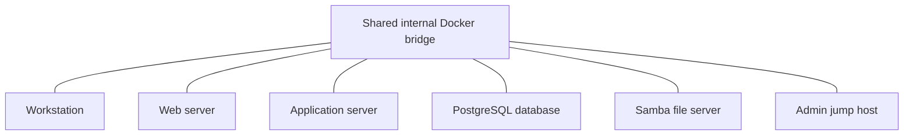
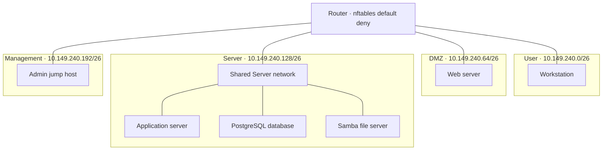

# PS2 · Flatland

Secure Networks Hackathon · Network segmentation and firewall design

Flatland compares what a compromised workstation could reach before and after network segmentation. The lab uses the same six workloads in both layouts. All eight approved business flows passed in both, while the segmented firewall blocked the tested workstation paths to internal services. [Integration report](docs/report.md)

## Problem statement

When workstations and servers share one network, a compromised workstation can reach databases, file shares, and management services directly. The goal is to cut off those paths while keeping the web application and routine administration working. Both layouts use the workstation as the starting point for controlled tests of that scenario.

## System architecture

### Before · Flat network

All six containers share one internal Docker bridge. They can reach one another directly, so the workstation can connect to services that it does not need for its job.



### After · Segmented network

Each workload attaches to one internal macvlan network. The router is the only container connected to all four zones. The diagram shows network attachments. The flow table below defines what may cross the router.



Docker Compose reuses the same service images, names, and synthetic fixtures in both layouts. Neither layout publishes lab service ports to the host. In the segmented layout, the router loads its policy before opening its zone interfaces to workload traffic. It allows the approved cross-zone connections and their established or related return traffic, then drops other forwarded traffic. Rate-limited drop records go through NFLOG to the router’s container log. [Addressing plan](docs/flow-matrix.md#segmented-addressing) · [Router ruleset](firewall/flatland.nft)

### Approved flows

| ID | Initiator | Destination | Port | Segmented path |
|---|---|---|---|---|
| B01 | Workstation | Web server | TCP 443 · HTTPS | User → DMZ via router |
| B02 | Web server | Application server | TCP 8080 · HTTP | DMZ → Server via router |
| B03 | Application server | Database | TCP 5432 · PostgreSQL | Direct within Server |
| B04–B08 | Admin jump host | Workstation, web, app, database, and file servers | TCP 22 · SSH | Management → each destination via router |

Management is the dedicated starting point for routine administration. For B04, the jump host initiates SSH to the workstation. The firewall permits replies to that session and denies a new workstation-initiated connection to Management. B03 stays inside the Server zone, so the router does not see it. [Full flow matrix](docs/flow-matrix.md)

## Reproduce the lab

Run these commands from the repository root. The segmented layout requires rootful Docker Engine 28.0 or newer on a Linux Docker host and Docker Compose 2.36 or newer. The host kernel needs dummy and macvlan links, nftables with connection tracking, and NFLOG. Use Bash for the validators and Python 3 for the optional dashboard. Check that `10.149.240.0/24` does not overlap any Docker network or connected VPN before starting. [Prerequisites and troubleshooting](docs/runbook.md#segmented-layout)

### 1. Establish the flat baseline

Start the flat project and wait for its services. Run the validator to check the eight approved flows and confirm that the workstation can reach the designated internal TCP ports.

```sh
docker compose -f lab/compose.services.yaml -f lab/compose.flat.yaml up --build --wait
bash scripts/check-security.sh flat
```

### 2. Repeat after segmentation

Start the segmented project alongside the flat one. The same validator reruns the business flows and looks for matching router drops when the workstation’s direct connections time out.

```sh
docker compose -f lab/compose.services.yaml -f lab/compose.segmented.yaml up --build --wait
bash scripts/check-security.sh segmented
docker compose -f lab/compose.services.yaml -f lab/compose.segmented.yaml logs --tail 40 router
```

The workstation validator calls the business validator in each layout. To run only B01–B08, use `bash scripts/check-business.sh flat` or `bash scripts/check-business.sh segmented`. The workstation validator covers fixed TCP paths, service health, read-only fixture checks, and drop-log correlation. SSH login, SMB share listing, and the synthetic upload were verified individually, with separate evidence. [Validation design](docs/security-validation.md) · [Application evidence](evidence/application-checks.json)

<a id="acceptance-checks"></a>

## Verified results

| Check | Flat baseline | Segmented result |
|---|---|---|
| B01–B08 · Approved business flows | **8 of 8 passed** | **8 of 8 passed** |
| S01 · Internal service ports | Workstation reached the application, PostgreSQL, and SMB ports | All three connections timed out. Approved HTTPS still passed. |
| S02 · Workstation SSH to database | Authorized lab login succeeded | SSH timed out with a matching firewall drop. Jump-host SSH still passed. |
| S03 · Workstation SMB share access | Workstation listed the share | SMB timed out with a matching firewall drop. The share remained healthy. |
| S04 · Synthetic SMB copy | Copy succeeded and the SHA-256 hashes matched. The uploaded file was removed. | Upload timed out with a matching firewall drop. The destination remained empty. |
| L01 · Firewall evidence | Baseline connectivity recorded | All four fixed TCP probes and all three individual application checks had matching router drops. |

[Flat integration log](evidence/integration-flat.log) · [Segmented integration log](evidence/integration-segmented.log) · [Application evidence](evidence/application-checks.json) · [ATT&CK and D3FEND mapping](docs/report.md#attck-mapping)

## Present the live demo

With both layouts running, start the dashboard.

```console
python demo/serve.py
```

Open the [local dashboard](http://127.0.0.1:8765/) and select **Workstation checks**, then **Play Flat**. When it stops, select **Segmented** and press **Play Segmented**. The replay traces the recorded paths and tallies connections that reached their destination or were blocked. Switch to **Business flows** to show the approved paths, including the direct application-to-database connection.

Select a result to inspect its recorded evidence. Expand **Live runtime** for current container health and router drops. The replay uses the checked-in evidence and sends no traffic, so it remains available when Docker is offline. [Six-minute demo outline](docs/report.md#six-minute-demo)

## Stop or reset the lab

Stop each project with `down`. Docker retains the database volumes. Use the reset commands in the runbook when you need a fresh database and clean fixture state.

```console
docker compose -f lab/compose.services.yaml -f lab/compose.segmented.yaml down
docker compose -f lab/compose.services.yaml -f lab/compose.flat.yaml down
```

[Flat reset](docs/runbook.md#reset-or-tear-down) · [Segmented reset](docs/runbook.md#reset-fixtures-and-tear-down)

## Repository guide

| Path | Contents |
|---|---|
| [lab/](lab/) | Compose layouts, service images, startup logic, and synthetic fixtures |
| [firewall/flatland.nft](firewall/flatland.nft) | Router forwarding policy and drop logging |
| [scripts/](scripts/) · [tests/](tests/) | Business and workstation validators, plus Docker-free regression checks |
| [docs/](docs/) | Topology, addressing and flow matrix, runbook, and integration report |
| [evidence/](evidence/) | Baseline and segmented logs, including the application checks |
| [demo/](demo/) | Local dashboard, live Docker status, and traffic replay |
