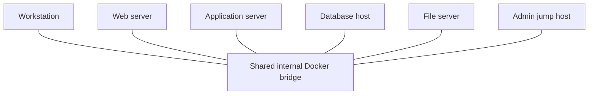
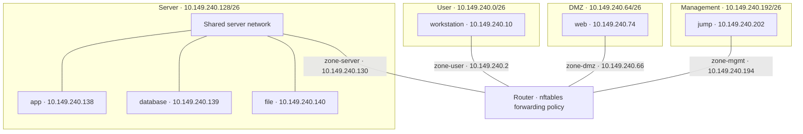

# Flatland topology

## Flat layout

All six workloads share the Docker bridge `flatland-flat_flat`. Docker assigns the addresses when the project starts.

## Segmented layout

Each zone has its own internal macvlan network and a separate Docker-created dummy parent link. Endpoints start in private mode and switch to bridge mode during startup. The router is the only container with an interface in more than one zone.

The diagram shows network attachments. Consult the [flow matrix](flow-matrix.md) for the permitted connections. For B01, the workstation reaches the DMZ subnet through `10.149.240.2` and the web server returns traffic through `10.149.240.66`. B03 follows the shared server network directly.
